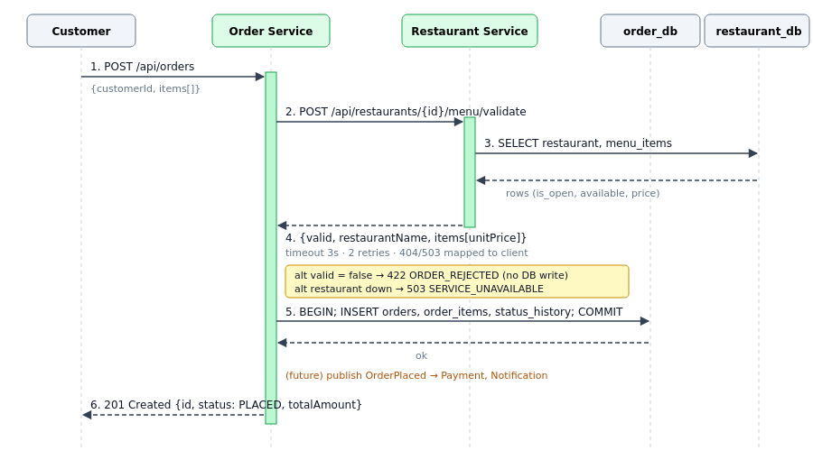
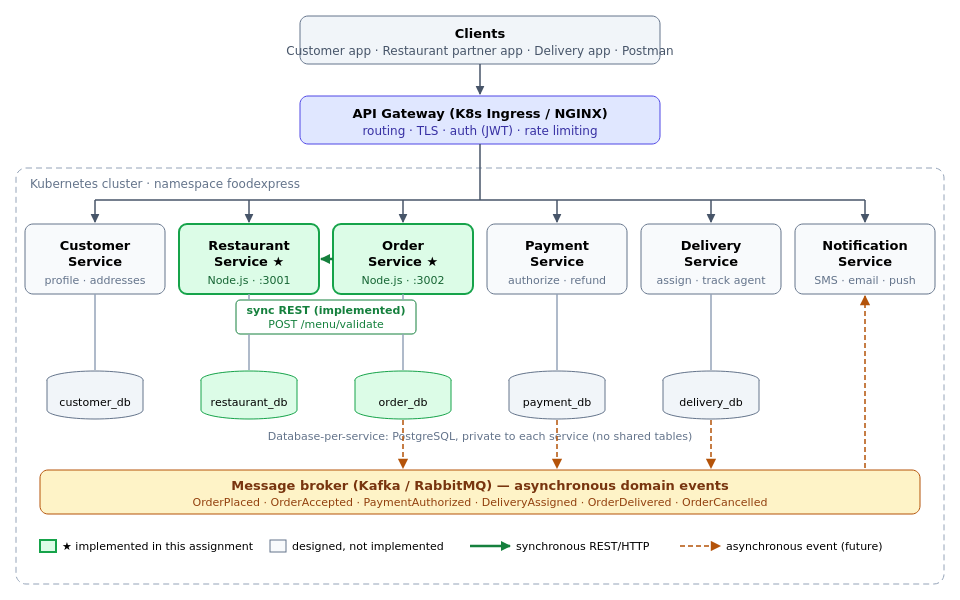
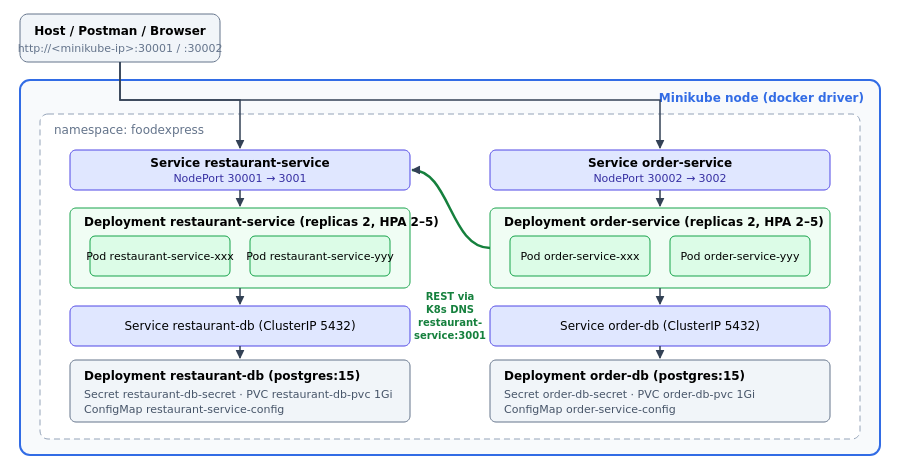

# FoodExpress — Microservices-based Online Food Ordering Application

| | |
|---|---|
| **Student** | Ajeet Kumar Yadav |
| **BITS ID** | 2025MT03083 |
| **Course** | Scalable Services — Assignment |
| **Application** | FoodExpress (online food ordering & delivery) |
| **Implemented services** | Restaurant Service, Order Service |
| **Deployment target** | Docker containers on a local Minikube Kubernetes cluster |

---

## 1. Application description

**FoodExpress** is an online food ordering platform similar to Swiggy or Zomato. It brings together customers, partner restaurants and delivery agents:

* **Customers** browse restaurants by city or cuisine, view menus, place orders, track order status and see their order history.
* **Restaurant partners** register their restaurant, manage the menu (add items, change prices, mark items unavailable), open or close the restaurant, and accept and prepare incoming orders.
* **Delivery agents** pick up prepared orders and mark them delivered.
* The platform takes payments and notifies every party as the order moves forward.

The core functional use case is **"Customer places a food order with a restaurant and tracks it until it is delivered."**

Traffic is very uneven. Lunch and dinner peaks can be 10–20× the off-peak load, and browsing menus (reads) far outnumbers placing orders (writes). A microservices architecture lets the read-heavy restaurant catalogue and the write-heavy order pipeline scale independently.

---

## 2. Part 1 — Design

### 2.1 System operations (commands and queries)

System operations come from the core use case. **Commands** change state; **queries** only read it.

| # | Operation | Type | Actor | Description |
|---|---|---|---|---|
| 1 | `registerCustomer()` | Command | Customer | Create a customer profile and delivery addresses |
| 2 | `registerRestaurant()` | Command | Restaurant partner | Register a new restaurant (name, cuisine, city, address) |
| 3 | `openOrCloseRestaurant()` | Command | Restaurant partner | Toggle whether the restaurant accepts orders |
| 4 | `addMenuItem()` | Command | Restaurant partner | Add a dish with price, category and veg flag |
| 5 | `updateMenuItem()` | Command | Restaurant partner | Change price or availability of a dish |
| 6 | `searchRestaurants()` | Query | Customer | List restaurants filtered by city, cuisine or open status |
| 7 | `getRestaurantDetails()` | Query | Customer | Fetch one restaurant |
| 8 | `browseMenu()` | Query | Customer | Fetch a restaurant's menu |
| 9 | `validateOrderItems()` | Query (internal) | Order Service | Check that items belong to the restaurant and are available; return authoritative prices |
| 10 | `placeOrder()` | Command | Customer | Create an order for a restaurant's menu items |
| 11 | `acceptOrder()` / `updateOrderStatus()` | Command | Restaurant / Delivery agent | Move the order through ACCEPTED → PREPARING → OUT_FOR_DELIVERY → DELIVERED |
| 12 | `cancelOrder()` | Command | Customer | Cancel an order that is not yet being prepared |
| 13 | `trackOrder()` | Query | Customer | Current status plus status history of an order |
| 14 | `getOrderHistory()` | Query | Customer / Restaurant | List orders by customer, restaurant or status |
| 15 | `authorizePayment()` / `refundPayment()` | Command | Payment gateway | Charge the customer; refund on cancellation |
| 16 | `assignDeliveryAgent()` | Command | System | Assign a nearby agent once the order is being prepared |
| 17 | `updateAgentLocation()` / `getDeliveryStatus()` | Command / Query | Delivery agent / Customer | Live delivery tracking |
| 18 | `sendNotification()` | Command | System | SMS, email or push on every order event |

### 2.2 Business capabilities → services

Services are decomposed by **business capability**. Each capability becomes one service that owns its data.

| Business capability | Service | Owns (data) |
|---|---|---|
| Customer management | **Customer Service** | customers, addresses |
| Restaurant & menu management | **Restaurant Service** ★ | restaurants, menu items |
| Order management | **Order Service** ★ | orders, order items, status history |
| Payment processing | **Payment Service** | payments, refunds |
| Delivery management | **Delivery Service** | agents, delivery assignments, locations |
| Customer & partner notification | **Notification Service** | templates, notification log |

★ = implemented in Part 2.

### 2.3 Assignment of operations to services and collaboration

| Service | Operations owned | Collaborators |
|---|---|---|
| Customer Service | registerCustomer, getCustomer | — |
| **Restaurant Service** | registerRestaurant, openOrCloseRestaurant, addMenuItem, updateMenuItem, searchRestaurants, getRestaurantDetails, browseMenu, **validateOrderItems** | Called by Order Service (sync) |
| **Order Service** | **placeOrder**, updateOrderStatus / acceptOrder, cancelOrder, trackOrder, getOrderHistory | Restaurant Service (sync REST, *implemented*); Customer Service (verify customer); publishes events to Payment, Delivery, Notification (async, *designed*) |
| Payment Service | authorizePayment, refundPayment | Consumes `OrderPlaced`, `OrderCancelled`; publishes `PaymentAuthorized` / `PaymentFailed` |
| Delivery Service | assignDeliveryAgent, updateAgentLocation, getDeliveryStatus | Consumes `OrderAccepted`; publishes `DeliveryAssigned`, `OrderDelivered` |
| Notification Service | sendNotification | Consumes every order, payment and delivery event |

**Collaboration for the `placeOrder` command (implemented):**

1. The customer calls `POST /api/orders` on the **Order Service**.
2. The Order Service calls the **Restaurant Service** synchronously: `POST /api/restaurants/{id}/menu/validate`.
3. The Restaurant Service checks that the restaurant exists and is open, and that each item belongs to it and is available. It returns the **authoritative name and unit price** of each item, so the Order Service never trusts a price sent by the client.
4. If validation passes, the Order Service stores the order, its items and a `PLACED` history entry in **its own database** in one local transaction, then returns `201 Created`.
5. *(Designed)* The Order Service publishes `OrderPlaced`. Payment authorizes the charge, the restaurant accepts, Delivery assigns an agent, and Notification informs the customer. This choreography is a **Saga**; the compensating action is `cancelOrder` → `refundPayment`.



### 2.4 Scalable architecture



Key design decisions:

| Concern | Decision |
|---|---|
| **Decomposition** | By business capability; one bounded context per service |
| **Data** | *Database-per-service*. Each service has its own private PostgreSQL instance; no tables are shared. The Order Service keeps a snapshot of item name and price (no cross-DB joins). |
| **Entry point** | API Gateway (Kubernetes Ingress / NGINX) for routing, TLS, auth and rate limiting |
| **Sync communication** | REST/JSON over HTTP when an immediate answer is needed (order validation). Calls go through a timeout, retries and error mapping (404 / 422 / 503). |
| **Async communication** | Domain events over a message broker (Kafka/RabbitMQ) for the long-running order Saga, so a failure in Payment or Notification does not block ordering |
| **Service discovery** | Kubernetes DNS (`http://restaurant-service:3001`) plus ClusterIP/NodePort Services that load-balance across pods |
| **Scalability** | Stateless services → horizontal scaling with `replicas: 2` and an **HPA** (2–5 pods at 70 % CPU). The read-heavy Restaurant Service can scale separately from the Order Service. |
| **Availability** | Readiness and liveness probes on `/health` (checks the DB too); rolling updates; DB connection retry on start-up |
| **Configuration** | ConfigMaps for settings; Secrets for DB credentials |

---

## 3. Part 2 — Implementation

### 3.1 Selected services

1. **Restaurant Service**: restaurant and menu management, including the internal `validateOrderItems` query.
2. **Order Service**: order placement and its lifecycle. It **collaborates with the Restaurant Service** on every new order.

### 3.2 Technology stack

| Layer | Technology | Reason |
|---|---|---|
| Language / runtime | **Node.js 18** (JavaScript) | Lightweight, fast start-up, good fit for I/O-bound REST services |
| Web framework | **Express 4** | Minimal, widely used REST framework |
| Database | **PostgreSQL 15**, one per service | ACID transactions for orders; relational menu model |
| DB driver | `pg` (node-postgres) with connection pool | |
| Inter-service communication | **Synchronous REST/JSON over HTTP** using `axios` (3 s timeout, 2 retries) | Order placement needs an immediate, consistent answer about item availability and price |
| Testing | Jest + Supertest + **pg-mem** (in-memory PostgreSQL) | Each service is tested independently with no external DB; the Order Service tests stub the Restaurant Service |
| Containerization | **Docker** (`node:18-alpine`), non-root user, HEALTHCHECK | |
| Orchestration | **Kubernetes on Minikube**: Deployments, Services, ConfigMaps, Secrets, PVCs, HPA, Ingress | |
| API testing | **Postman** collection | |

### 3.3 Why synchronous REST between these two services

`placeOrder` cannot continue until it knows the items are valid and what they cost, so the call is a request/response query by nature. To limit the coupling a synchronous call brings:

* the Order Service calls through a client with a **timeout and retries** (`restaurantClient.js`);
* failures are mapped to clear status codes: restaurant not found → `404`, items rejected → `422`, Restaurant Service unreachable → `503`. The Order Service itself stays up;
* the Order Service **stores a snapshot** of names and prices, so later queries (`trackOrder`, `getOrderHistory`) **never** call the Restaurant Service.

Downstream steps (payment, delivery, notification) are designed to be **asynchronous events**, as described in §2.3.

### 3.4 Project structure (each service is a separate repository)

Each of `restaurant-service/` and `order-service/` is a **self-contained repository**: its own `package.json`, source, tests, Dockerfile, docker-compose file and Kubernetes manifests. Each can be built, tested and deployed alone.

```
2025MT03083_FoodExpress/
├── restaurant-service/            ← repository 1
│   ├── src/
│   │   ├── server.js              # bootstrap: wait for DB, create schema, seed, listen
│   │   ├── app.js                 # express app, /health, error handling
│   │   ├── db.js                  # pg pool, schema, connection retry
│   │   ├── mappers.js             # row → API object
│   │   ├── seed.js                # demo restaurants & menus
│   │   └── routes/restaurants.js  # REST endpoints (commands & queries)
│   ├── tests/restaurant.test.js   # 8 tests (Jest + pg-mem)
│   ├── k8s/
│   │   ├── restaurant-db.yaml     # Secret, PVC, Postgres Deployment, Service
│   │   └── restaurant-service.yaml# ConfigMap, Deployment, NodePort Service, HPA
│   ├── Dockerfile
│   ├── docker-compose.yml         # run standalone with its own DB
│   └── package.json
├── order-service/                 ← repository 2
│   ├── src/
│   │   ├── server.js
│   │   ├── app.js
│   │   ├── db.js                  # orders, order_items, order_status_history
│   │   ├── orderStatus.js         # order state machine
│   │   ├── restaurantClient.js    # REST client → Restaurant Service (timeout/retry)
│   │   └── routes/orders.js       # REST endpoints (commands & queries)
│   ├── tests/order.test.js        # 9 tests (Restaurant Service stubbed)
│   ├── k8s/
│   │   ├── order-db.yaml
│   │   └── order-service.yaml
│   ├── Dockerfile
│   ├── docker-compose.yml
│   └── package.json
├── deployment/
│   ├── k8s/00-namespace.yaml      # namespace foodexpress
│   ├── k8s/10-ingress.yaml        # optional API gateway
│   ├── deploy-minikube.sh         # one-shot build + deploy
│   ├── smoke-test.sh              # end-to-end calls for the demo
│   └── cleanup.sh
├── postman/2025MT03083_Ajeet_Kumar_Yadav_FoodExpress.postman_collection.json
├── docs/                          # this document + diagrams
├── screenshots/                   # Postman, kubectl, dashboard snapshots
└── video/                         # demo screen recording
```

### 3.5 Data model

**restaurant_db** (Restaurant Service)

| Table | Columns |
|---|---|
| `restaurants` | id (PK), name, cuisine, city, address, rating, is_open, created_at |
| `menu_items` | id (PK), restaurant_id (FK), name, description, category, price, is_veg, available, created_at |

**order_db** (Order Service)

| Table | Columns |
|---|---|
| `orders` | id (PK), customer_id, restaurant_id, restaurant_name *(snapshot)*, delivery_address, status, total_amount, created_at, updated_at |
| `order_items` | id (PK), order_id (FK), menu_item_id, name *(snapshot)*, unit_price *(snapshot)*, quantity |
| `order_status_history` | id (PK), order_id (FK), status, changed_at |

`restaurant_id` and `menu_item_id` in `order_db` are **logical references** only. There is no foreign key across databases.

### 3.6 REST API

**Restaurant Service** (port 3001)

| Method | Endpoint | Operation | Success |
|---|---|---|---|
| GET | `/health` | health/readiness | 200 |
| POST | `/api/restaurants` | registerRestaurant | 201 |
| GET | `/api/restaurants?city=&cuisine=&open=` | searchRestaurants | 200 |
| GET | `/api/restaurants/{id}` | getRestaurantDetails | 200 / 404 |
| PATCH | `/api/restaurants/{id}/status` | openOrCloseRestaurant | 200 |
| POST | `/api/restaurants/{id}/menu` | addMenuItem | 201 |
| GET | `/api/restaurants/{id}/menu` | browseMenu | 200 |
| PATCH | `/api/restaurants/{id}/menu/{itemId}` | updateMenuItem | 200 |
| POST | `/api/restaurants/{id}/menu/validate` | validateOrderItems (internal) | 200 |

**Order Service** (port 3002)

| Method | Endpoint | Operation | Success / errors |
|---|---|---|---|
| GET | `/health` | health/readiness | 200 |
| POST | `/api/orders` | placeOrder → calls Restaurant Service | 201 / 400 / 404 / 422 / 503 |
| GET | `/api/orders?customerId=&restaurantId=&status=` | getOrderHistory | 200 |
| GET | `/api/orders/{id}` | trackOrder | 200 / 404 |
| PATCH | `/api/orders/{id}/status` | updateOrderStatus / acceptOrder | 200 / 409 invalid transition |
| POST | `/api/orders/{id}/cancel` | cancelOrder | 200 / 409 |

**Order state machine:** `PLACED → ACCEPTED → PREPARING → OUT_FOR_DELIVERY → DELIVERED`. `CANCELLED` is allowed only from `PLACED` or `ACCEPTED`.

Sample `placeOrder` request and response:

```json
POST /api/orders
{
  "customerId": "cust-2025MT03083",
  "restaurantId": "rest-001",
  "deliveryAddress": "BITS Pilani WILP, Bengaluru",
  "items": [ { "menuItemId": "item-101", "quantity": 2 },
             { "menuItemId": "item-102", "quantity": 4 } ]
}

201 Created
{
  "id": "ord-6375787f",
  "customerId": "cust-2025MT03083",
  "restaurantId": "rest-001",
  "restaurantName": "Spice Garden",
  "status": "PLACED",
  "totalAmount": 678,
  "items": [
    { "menuItemId": "item-101", "name": "Paneer Butter Masala", "unitPrice": 249, "quantity": 2, "lineTotal": 498 },
    { "menuItemId": "item-102", "name": "Butter Naan", "unitPrice": 45, "quantity": 4, "lineTotal": 180 }
  ],
  "statusHistory": [ { "status": "PLACED", "changedAt": "..." } ]
}
```

### 3.7 Implementation steps

1. **Domain analysis.** Identified the actors, the core use case, the system operations (§2.1) and the business capabilities (§2.2).
2. **Service scaffolding.** Created two independent Node.js projects (`restaurant-service`, `order-service`), each with its own dependencies.
3. **Persistence.** Wrote a PostgreSQL schema per service, created at start-up (`CREATE TABLE IF NOT EXISTS`). The service retries the DB connection so it tolerates the DB pod starting late. The Restaurant Service seeds demo restaurants and menus.
4. **REST endpoints.** Implemented the commands and queries from §3.6, with input validation and consistent JSON errors.
5. **Inter-service communication.** Built `restaurantClient.js` in the Order Service (axios, timeout, retries, error mapping) and the matching `/menu/validate` endpoint in the Restaurant Service.
6. **Order lifecycle.** Implemented the state machine (`orderStatus.js`) and transactional status changes with history.
7. **Testing.** Wrote unit and integration tests per service using an in-memory PostgreSQL; the Order Service tests stub the Restaurant Service. **17/17 tests pass.** An end-to-end run with both services over real HTTP was also checked.
8. **Containerization.** Wrote a `Dockerfile` per service (Alpine, production deps only, non-root, HEALTHCHECK) and a `docker-compose.yml` per service for standalone runs.
9. **Kubernetes manifests.** Wrote a Namespace, plus per service: Secret, PVC, Postgres Deployment and Service, ConfigMap, app Deployment (2 replicas, probes, resource limits), NodePort Service and HPA. An Ingress acts as the gateway.
10. **Deployment.** Started Minikube, built the images inside Minikube's Docker daemon, applied the manifests and waited for the rollouts.
11. **Verification.** Exercised every endpoint through Postman and `smoke-test.sh`, then inspected the workloads in the Kubernetes Dashboard.

### 3.8 Test results

```
restaurant-service$ npm test
 PASS tests/restaurant.test.js
  ✓ GET /health reports UP
  ✓ lists seeded restaurants and filters by cuisine
  ✓ registers a restaurant and adds a menu item
  ✓ rejects invalid restaurant payload
  ✓ returns 404 for unknown restaurant
  ✓ validate returns authoritative prices
  ✓ validate flags items from another restaurant and unavailable items
  ✓ validate rejects orders when restaurant is closed
 Tests: 8 passed, 8 total

order-service$ npm test
 PASS tests/order.test.js
  ✓ places an order with prices from restaurant service
  ✓ rejects missing fields
  ✓ returns 422 when restaurant rejects items
  ✓ returns 404 for unknown restaurant
  ✓ returns 503 when restaurant service is down
  ✓ tracks order through full lifecycle
  ✓ rejects invalid status transition
  ✓ cancels a placed order but not a delivered one
  ✓ lists order history by customer
 Tests: 9 passed, 9 total
```

---

## 4. Part 3 — Deployment

### 4.1 Deployment plan



| K8s object | restaurant-service | order-service |
|---|---|---|
| Namespace | `foodexpress` | `foodexpress` |
| Database Deployment + ClusterIP Service | `restaurant-db` :5432 | `order-db` :5432 |
| Secret (DB credentials) | `restaurant-db-secret` | `order-db-secret` |
| PersistentVolumeClaim | `restaurant-db-pvc` (1 Gi) | `order-db-pvc` (1 Gi) |
| ConfigMap | `restaurant-service-config` | `order-service-config` (includes `RESTAURANT_SERVICE_URL=http://restaurant-service:3001`) |
| App Deployment | `restaurant-service`, 2 replicas | `order-service`, 2 replicas |
| App Service | NodePort **30001** → 3001 | NodePort **30002** → 3002 |
| HPA | 2–5 pods @ 70 % CPU | 2–5 pods @ 70 % CPU |
| Probes | readiness + liveness on `/health` | readiness + liveness on `/health` |

**Docker containers:** each microservice runs in its **own Docker container** (`restaurant-service:1.0`, `order-service:1.0`), and each database runs in its own `postgres:15-alpine` container.

### 4.2 Prerequisites

* Docker (with your user in the `docker` group)
* `minikube` ≥ 1.30 and `kubectl`
* Postman

### 4.3 Step-by-step deployment

```bash
# 1. Start Minikube and enable the addons
minikube start --driver=docker --cpus=2 --memory=4096
minikube addons enable metrics-server
minikube addons enable dashboard

# 2. Build the images inside Minikube's Docker daemon (no registry needed)
eval $(minikube docker-env)
docker build -t restaurant-service:1.0 ./restaurant-service
docker build -t order-service:1.0 ./order-service

# 3. Deploy
kubectl apply -f deployment/k8s/00-namespace.yaml
kubectl apply -f restaurant-service/k8s/
kubectl apply -f order-service/k8s/

# 4. Verify
kubectl -n foodexpress get deployments,pods,svc,hpa -o wide
kubectl -n foodexpress logs deploy/order-service

# 5. Get the service URLs
minikube ip                       # → e.g. 192.168.49.2 → :30001 / :30002
minikube service restaurant-service order-service -n foodexpress --url

# 6. Smoke test and dashboard
./deployment/smoke-test.sh
minikube dashboard
```

The same steps are scripted in `deployment/deploy-minikube.sh`.

**Independent deployment of one service.** For example, to roll out a new Order Service build without touching the Restaurant Service:

```bash
eval $(minikube docker-env)
docker build -t order-service:1.1 ./order-service
kubectl -n foodexpress set image deployment/order-service order-service=order-service:1.1
kubectl -n foodexpress rollout status deployment/order-service
```

**Scaling demo:**

```bash
kubectl -n foodexpress scale deployment/restaurant-service --replicas=3
kubectl -n foodexpress get pods -l app=restaurant-service
```

### 4.4 Kubernetes Dashboard analysis

Open with `minikube dashboard` and choose namespace **foodexpress**.

* **Workloads → Deployments:** four deployments (`restaurant-service`, `order-service`, `restaurant-db`, `order-db`), all green, with the expected pod counts (2/2, 2/2, 1/1, 1/1).
* **Pods:** six pods in *Running* state. Each pod's logs show incoming requests, e.g. `[order-service] POST /api/orders`. Requests spread across both replicas, as the `pod` field returned by `/health` shows.
* **Replica Sets:** one ReplicaSet per deployment revision; after `set image`, a new ReplicaSet appears and the old one scales to 0 (rolling update).
* **Services:** NodePort 30001/30002 for the apps and ClusterIP for the databases. Each service's endpoints list the pod IPs.
* **Config and Storage:** ConfigMaps, Secrets and two Bound PVCs.
* **Horizontal Pod Autoscalers:** current versus target CPU utilisation for both app deployments.
* **CPU/Memory graphs** (from metrics-server): per-pod resource usage stays within the declared requests and limits.

---

## 5. Snapshots

> Screenshots are stored in `screenshots/` and named with the prefix `2025MT03083_Ajeet_Kumar_Yadav_`.

### 5.1 Minikube cluster and kubectl


### 5.2 Postman: Restaurant Service


### 5.3 Postman: Order Service (with the inter-service call)


### 5.4 Kubernetes Dashboard


---

## 6. Demonstration video

`video/2025MT03083_Ajeet_Kumar_Yadav_FoodExpress_Demo.mp4` shows:

1. The project structure and the two separate service repositories
2. `minikube start` and `minikube status`
3. Building both Docker images inside Minikube
4. `kubectl apply` of all manifests and `kubectl get all -n foodexpress`
5. The Postman calls: search restaurants → browse menu → place order (Order Service → Restaurant Service) → status updates → track order → negative cases
6. The Kubernetes Dashboard: deployments, pods, logs, services, HPA
7. Scaling a deployment and watching new pods appear

---

## 7. Conclusion

FoodExpress is decomposed by business capability into six microservices, each owning its own database. The Restaurant and Order services are implemented as independent Node.js repositories with PostgreSQL. They talk over resilient synchronous REST, are packaged as separate Docker containers, and are deployed to a local Minikube cluster with replicas, health probes, configuration, secrets, persistent storage and autoscaling. The remaining services and the event-driven Saga are designed to plug into the same platform.

*— 2025MT03083 / Ajeet Kumar Yadav*
